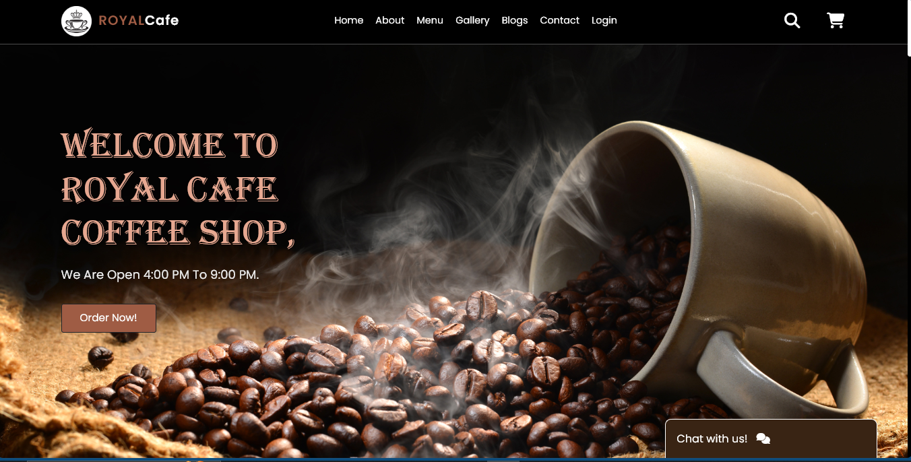
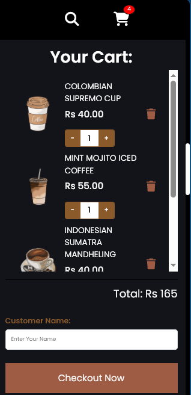
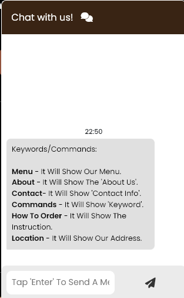
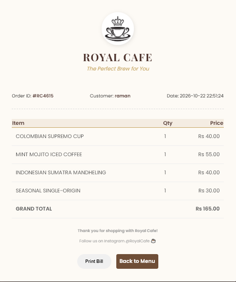

# ☕ Royal Cafe – Coffee Shop Website

A dynamic coffee shop website with user login, shopping cart, order invoice and a chatbot, built with **PHP, MySQL, JavaScript and CSS**.
This was our **BCA Final Year Project**.



---

## 📸 Screenshots

| Login | Cart (mobile view) |
|:-----:|:------------------:|
|  |  |

| Chatbot | Invoice / Bill |
|:-------:|:--------------:|
|  |  |

---

## ✨ Features

- 🔐 **User Registration & Login** with PHP sessions
- 🛒 **Shopping Cart**: add items, change quantity, remove items, live total
- 🧾 **Invoice / Bill generation** with a unique order ID, date and grand total
- 🖨️ **Print Bill** button on the invoice page
- 💾 **Orders stored in MySQL** database against the logged-in user
- 🤖 **Chatbot** that answers keywords like `menu`, `about`, `contact`, `location`, `how to order`
- 📱 **Responsive design** with navbar, search box and cart sidebar
- 🖼️ Home, About, Menu, Gallery, Blogs, Reviews and Contact sections

---

## 🛠️ Tech Stack

| Layer | Technology |
|-------|------------|
| Frontend | HTML5, CSS3, JavaScript, jQuery |
| Backend | PHP |
| Database | MySQL |
| Local Server | WAMP |

---

## 📁 Project Structure

```
coffeeshop/
├── index.php              # Public home page
├── assets/
│   ├── css/               # Stylesheets (style, login, invoice, chatbot)
│   ├── js/                # Cart logic, chatbot logic and responses
│   └── images/            # Images and logo
├── users/                 # Logged-in area
│   ├── login.php
│   ├── registration.php
│   ├── logout.php
│   ├── index.php          # Menu + cart (after login)
│   ├── invoice.php        # Bill generation
│   ├── add_to_database.php
│   ├── auth_session.php
│   └── db.php             # Database connection
└── DATABASE/
    └── royalcoffee.sql    # Database structure
```

---

## 🚀 How to Run Locally

1. Install [WampServer](https://www.wampserver.com/) (or XAMPP) and start **Apache** and **MySQL**.
2. Clone or download this repo and put the `coffeeshop` folder inside the `www` folder (for XAMPP: `htdocs`).
   ```bash
   git clone https://github.com/Kanav3/brewvoyage-coffeeshop.git coffeeshop
   ```
3. Open **phpMyAdmin** (`http://localhost/phpmyadmin`).
4. Go to the **Import** tab and import `DATABASE/royalcoffee.sql` (it creates the `royalcoffee` database and tables).
5. Check `users/db.php`. The default settings are `localhost`, user `root`, empty password. Change them if yours are different.
6. Open in the browser:
   - Website: `http://localhost/coffeeshop/`
   - Login: `http://localhost/coffeeshop/users/login.php`

---

## 👥 Team

| Name | Contribution |
|------|--------------|
| **Kanav Sharma** | Overall development, cart & checkout flow, invoice generation, database design, chatbot integration |
| **Krishna** | Part of the JavaScript and PHP code |

---

## 🙏 Acknowledgements

The front-end layout and chatbot interface were built on top of freely available templates and tutorials found online, and then extended with our own functionality (login system, database orders, invoice, etc.).
<!-- Yahan original template / tutorial ka link daalo: [Template name](link) -->

---

## ⚠️ Known Limitations & Future Improvements

This is a student project, so there is room to grow:

- [ ] Use `password_hash()` / `password_verify()` instead of MD5 for passwords
- [ ] Use prepared statements (PDO / MySQLi) to prevent SQL injection
- [ ] Admin panel to manage products and view orders
- [ ] Online payment gateway integration
- [ ] Order history page for users
- [ ] Move the product list from HTML into the database

---

## 📄 License

This project was made for educational purposes.
